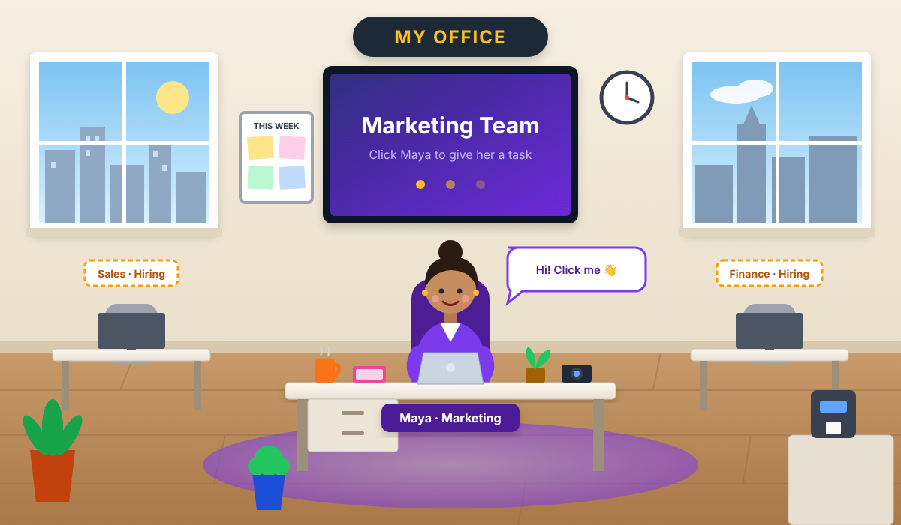
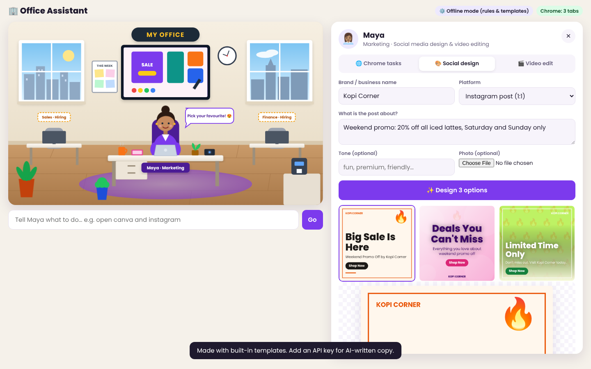

# 🏢 Office Assistant

A virtual office of AI workers that do real tasks on your computer. The first hire is **Maya from Marketing**. She designs social media posts, edits videos, and drives Google Chrome for you: she opens tabs, searches, types and clicks while you watch.



## Start it

**Easiest:** install [Node.js LTS](https://nodejs.org) and [Google Chrome](https://www.google.com/chrome), then double-click **`Start Office Assistant (Windows).bat`** or **`Start Office Assistant (Mac).command`** in the main folder. The office opens at http://localhost:4100.

**From a terminal:**

```bash
cd office-assistant
npm install
npm start                                   # works offline with built-in rules and templates
ANTHROPIC_API_KEY=sk-ant-... npm start      # Maya plans tasks and writes copy with Claude
```

Click **Maya** in the office to open her workspace, or type a task in the bar under the office.

## What Maya can do



### 🌐 Chrome tasks
Maya opens a **real, visible Chrome window** and works in it. Try:

- `open canva, capcut, instagram and tiktok`
- `search youtube for coffee shop reel ideas`
- `search unsplash for iced latte`
- `open google, then type marketing ideas for a bakery and press enter`
- `search latte art on pinterest`, `list tabs`, `close tab`, `click Sign in`

| Without an API key | With `ANTHROPIC_API_KEY` |
|---|---|
| Follows the commands above (open, search, type, press, click, close, list tabs) | Claude plans the steps itself, reads pages as it goes, and handles free-form requests like "find 5 trending audio ideas for a café reel and open them in tabs" |

Chrome uses its own profile in `office-assistant/data/chrome-profile`, because Chrome locks your everyday profile while it's running. Log in to Instagram, Canva and other sites once in that window and they stay logged in. Maya never types passwords. She won't post, pay or send messages unless you ask for exactly that.

### 🎨 Social media design
Enter your brand and what the post is about. Maya makes **3 design options** at the platform's real size:
Instagram post (1080×1080), story/TikTok cover (1080×1920), Facebook, LinkedIn, X and YouTube thumbnail.

- Add a product photo to use it in the design
- Edit the headline, text, button, layout (bold, split, minimal, gradient, frame) and colours live
- **Download PNG**, **copy the caption + hashtags**, or let Maya **open the platform in Chrome** so you can post it

### 🎬 Video editing
Load a clip and edit it in the browser. Your video never leaves your computer.

- Trim the start and end
- Reframe to **9:16** (Reels/TikTok/Shorts), 1:1, 4:5 or 16:9, cropped to fill or fitted with blurred bars
- Speed (0.5×–2×), filters (vivid, warm, cool, B&W, vintage), fade in/out, watermark
- Timed text on screen. **✨ Maya, write captions** writes a hook, the overlays, a post caption, hashtags and music ideas
- **Export** to MP4 (or WebM on older Chrome). Keep the tab open while it exports, because it records in real time.

## Settings

| Variable | Default | What it does |
|---|---|---|
| `ANTHROPIC_API_KEY` | none | Turns on Claude for task planning and copywriting |
| `CLAUDE_MODEL` | `claude-opus-5-5` | Model Maya uses |
| `PORT` | `4100` | Web port. The server only listens on this computer (127.0.0.1) |
| `CHROME_PATH` | Chrome | Use another Chrome/Chromium program |
| `CHROME_PROFILE_DIR` | `data/chrome-profile` | Where Maya's Chrome profile is kept |
| `HEADLESS` | off | `1` runs Chrome hidden (for testing) |

## Hiring more workers

The **Sales** and **Finance** desks are empty for now. Each worker is a desk in `public/office.svg` plus a panel in `public/index.html`. Their skills live in `server/` (Chrome control in `browser.js` and `agent.js`, Maya's copywriting in `marketing.js`).

```bash
npm test     # parser, URL and template tests
```
